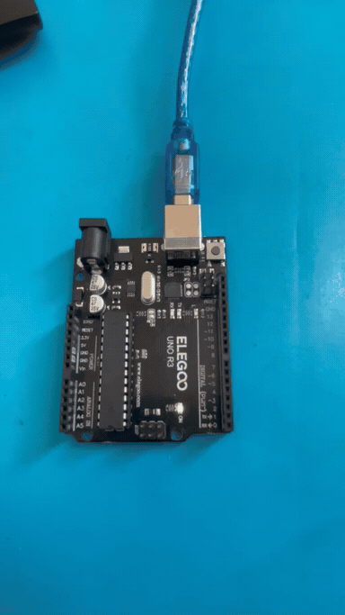
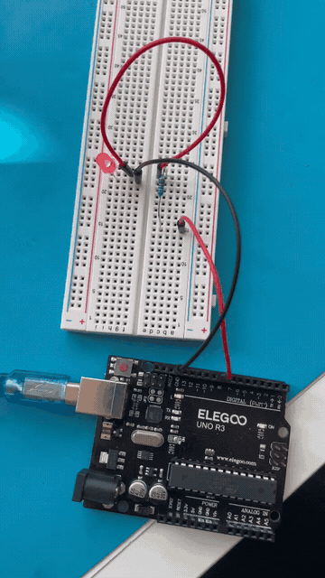

# Arduino Learning

A collection of hands-on Arduino exercises developed using an **Arduino UNO** and **PlatformIO (VS Code)**.

This repository documents my progress in learning embedded programming, electronics, and C++ as preparation for building an **autonomous rover**.

## Development Environment

- **Board:** Arduino UNO
- **Language:** C++
- **IDE:** Visual Studio Code + PlatformIO
- **Hardware:** ELEGOO UNO Super Starter Kit

## Lessons

### Lesson 02: Blink

**Objective:** Blink the Arduino UNO's built-in LED (D13) at 0.5-second intervals.

**Demo**

---

### Lesson 03: LED

**Objective:** Build a simple LED circuit using a breadboard and a current-limiting resistor, then control the LED through digital pin D7 (500 ms ON / 500 ms OFF).

**Demo**

## Next Goal: Autonomous Rover

After completing the Arduino fundamentals, I plan to build an autonomous rover capable of sensing obstacles and controlling its movement.

## Acknowledgment

Exercises are based on the ELEGOO UNO Super Starter Kit tutorials, with my own code and experiments.
